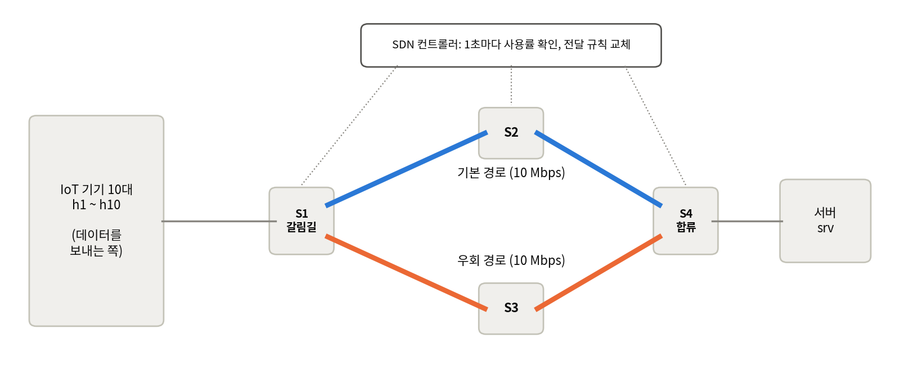
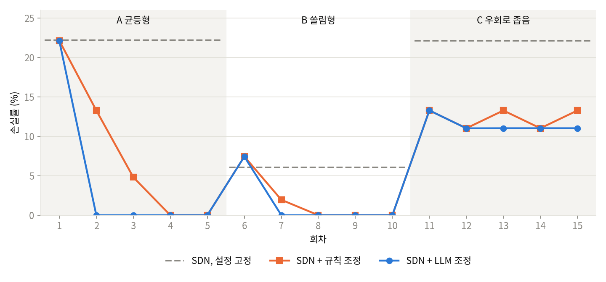

# SDN_Control_Project

**트래픽 폭주가 지나갈 때마다 LLM 이 기록을 읽고 SDN 의 우회 설정을 고쳐, 다음 폭주를 더 잘 막는 시스템**

IoT 기기는 같은 사건에 동시에 반응합니다. 정전이 나면 스마트 계량기가 한꺼번에 보고를 보내고, 사건이 나면 CCTV 가 고화질 영상을 올립니다. 이때 한 경로에 트래픽이 몰려 데이터가 버려집니다. SDN 은 몰린 트래픽을 다른 경로로 나눠 보낼 수 있지만, **언제부터, 얼마나** 나눠 보낼지는 사람이 미리 정한 숫자에 달려 있습니다. 이 프로젝트는 그 숫자를 LLM 이 회차마다 다시 정하게 했습니다.

## 한눈에 보기



- IoT 기기 10대가 서버로 데이터를 보냅니다. 길은 **기본 경로**와 **우회 경로** 두 개이고, 각각 10 Mbps 까지 보낼 수 있습니다.
- 평소에는 기본 경로만 씁니다. 트래픽이 몰려 기본 경로가 차면 SDN 컨트롤러가 일부 기기의 트래픽을 우회 경로로 보냅니다.
- 컨트롤러의 동작은 숫자 두 개로 정해집니다.

| 설정값 | 뜻 | 예 |
|---|---|---|
| `threshold` (우회 시작 기준, %) | 기본 경로 사용률이 이 값 이상이 되면 우회 전환을 시작한다 | 80 이면 8 Mbps 이상 흐를 때 시작 |
| `split_ratio` (우회 비율, %) | 전체 기기 중 이 비율만큼의 트래픽을 우회 경로로 보낸다 | 30 이면 10대 중 3대 |

## 누가 무엇을 하나

이 시스템은 두 부분으로 나뉩니다.

| 역할 | 하는 일 | 언제 |
|---|---|---|
| **SDN 컨트롤러** | 설정값 두 개를 그대로 따라 우회를 실행한다. 값이 좋은지 나쁜지는 판단하지 않는다 | 폭주가 진행되는 동안 |
| **조정자** | 기록을 보고 설정값 두 개를 다시 정한다 | 폭주가 끝난 뒤 |

LLM 이 맡는 것은 **조정자**입니다. LLM 은 스위치를 직접 건드리지 않습니다. 회차가 끝날 때마다 기록 요약을 프롬프트로 받고, 숫자 두 개를 돌려줄 뿐입니다.

```
폭주 → SDN 이 설정값대로 우회 → 기록(CSV) → 요약을 프롬프트로 → LLM 이 새 설정값 제안(JSON)
   ↑                                                                        │
   └──── 다음 폭주 ← SDN 이 새 설정값을 읽음 ← params.yaml 에 기록 ← 범위 검사 ←┘
```

**프롬프트에 넣는 것**: 이번 회차에 쓴 설정값, 경로별 부하와 사용률, 버려진 패킷 수(경로별), 우회 전환 시점, 손실률, 기기별 송신량, 링크 가용 대역, 최근 회차 이력, 허용 범위. 여기에 일반적인 튜닝 요령을 적은 [knowledge.md](knowledge.md) 를 통째로 붙입니다. 폭주의 종류나 정답은 알려주지 않습니다.

실행하면 회차마다 주고받은 프롬프트와 응답이 `runs/<실행이름>/llm/` 에 저장됩니다.

## 실험

폭주를 세 종류로 만들고, 설정값을 초기화하지 않은 채 A 5회 → B 5회 → C 5회를 이어서 재생했습니다.

| 시나리오 | 실제 상황 | 트래픽 | 가장 좋은 우회 비율 |
|---|---|---|---|
| A 균등형 | 정전 시 스마트 계량기가 동시에 보고 | 10대가 각 1.8 Mbps | 50% (손실 0) |
| B 쏠림형 | 사건이 난 CCTV 만 고화질 전송 | 3대가 각 3 Mbps, 나머지 7대가 합 8 Mbps | 30% (손실 0) |
| C 우회로 좁음 | 우회 경로를 다른 서비스와 나눠 씀 (6 Mbps 만 사용 가능) | A 와 같음 | 40% (손실을 0 으로 만들 수 없음) |

같은 SDN 에 조정자만 바꿔 세 방식을 비교했습니다.

| 방식 | 조정자 |
|---|---|
| SDN, 설정 고정 | 없음. 초기값(threshold 90, split_ratio 20)을 끝까지 유지 |
| SDN + 규칙 조정 | 조건문 몇 줄짜리 프로그램. 버려진 패킷이 많은 쪽의 부하를 줄이도록 우회 비율을 10씩 변경 |
| SDN + LLM 조정 | LLM (Claude Opus) |

### 결과



| 평균 손실률 | SDN, 설정 고정 | SDN + 규칙 조정 | SDN + LLM 조정 |
|---|---|---|---|
| A 균등형 | 22.2% | 8.0% | 4.4% |
| B 쏠림형 | 6.1% | 1.9% | 1.5% |
| C 우회로 좁음 | 22.1% | 12.4% | 11.5% |
| **전체 15회차** | **16.8%** | **7.4%** | **5.8%** |

- **설정을 고정하면 손실이 계속됩니다.** 매 회차 6~22% 가 버려졌습니다.
- **한 번 찾은 값은 폭주가 바뀌면 틀립니다.** A 에서 찾은 50% 를 B 에 그대로 쓰자 손실이 7.4% 로, 설정을 고정한 경우(6.1%)보다 나빴습니다.
- **LLM 은 더 적은 회차로 알맞은 값에 도달했습니다.** A 에서 규칙 조정은 네 번째 회차에, LLM 은 두 번째 회차에 도달했습니다. LLM 은 기록에서 경로별 부하를 직접 계산했습니다.
- **LLM 은 더 바꾸지 않아야 할 때를 구분했습니다.** C 에서 규칙 조정은 최적값에 도달한 뒤에도 값을 바꿨다 되돌리기를 반복했지만, LLM 은 "초과량이 가장 작은 값이므로 유지한다"며 멈췄습니다.

B 로 바뀐 직후 LLM 이 남긴 근거의 일부입니다.

> 송신량이 큰 h1~h3(각 3.0 Mbps)가 배분을 좌우하므로 호스트 수 비율이 아닌 실제 트래픽으로 계산. split_ratio=40 은 우회로 10.40 Mbps 로 여전히 0.4 Mbps 초과. split_ratio=30 이면 우회로 9.27 Mbps(93%), 기본 경로 7.93 Mbps(79%)로 양쪽 모두 가용 대역 이하.

### 한계

- **각 방식을 한 번씩만 실행했습니다.** 가상망은 같은 설정에서 같은 결과가 나오지만, LLM 의 응답은 매번 같다는 보장이 없습니다. 반복 검증이 필요합니다.
- **LLM 의 우위는 요령 문서에 기대고 있습니다.** "기기별 송신량으로 부하를 계산하라", "손실을 0 으로 만들 수 없으면 초과량이 가장 작은 값에서 멈춰라"를 문서로 주었습니다. 같은 계산을 프로그램으로 짜면 규칙 조정도 같은 결과를 낼 수 있습니다. 이 실험이 보여주는 것은 "LLM 이 어떤 규칙보다 낫다"가 아니라, **상황마다 규칙을 따로 만들지 않고도 글로 쓴 요령과 기록만으로 세 상황에 맞게 판단하고 이유를 남겼다**는 점입니다.
- **`threshold` 의 효과는 확인하지 못했습니다.** 폭주가 서서히 오르는 조건에서는 우회 전환 시점이 손실에 영향을 주지 않았습니다.
- 폭주가 바뀐 첫 회차의 손실은 어느 방식도 피하지 못합니다.

## 파일 구성

| 파일 | 역할 |
|---|---|
| `topo.py` | 가상망 정의 (기기, 스위치, 배선, IP, 용량) |
| `gns3_build.py` | GNS3 에 프로젝트를 만들고 노드를 켜고 끈다 |
| `apply.py` | 노드를 켠 뒤 스위치와 기기에 설정을 넣는다 |
| `controller.py` | SDN 컨트롤러 (Ryu, OpenFlow 1.3). 설정값에 따라 우회 실행 |
| `monitor.py` | 10초마다 사용률, 버려진 패킷 수, 기기별 송신량을 CSV 로 기록 |
| `surge.py` | 폭주 재생 (시나리오 A, B, C) |
| `advisor.py` | 조정자. 기록 요약, LLM 호출, 범위 검사, 반영, 되돌리기 |
| `knowledge.md` | LLM 프롬프트에 붙이는 튜닝 요령 |
| `params.yaml` | 설정값 두 개와 허용 범위 |
| `run.sh` | 회차 반복 실행 |
| `ctl.sh` | 컨트롤러 켜기, 끄기 |
| `verify_scenarios.py` | 가상망이 계산대로 동작하는지 검증 |
| `plot.py` | 그래프 |
| `docs/` | 이 문서에 쓰인 그림 |

## 실행 방법

**필요한 것**
- GNS3 서버 2.2 와 Docker. 이미지 `gns3/openvswitch`, 그리고 `iperf3` 가 들어 있는 리눅스 이미지(`topo.py` 의 `HOST_IMAGE`)
- Python 3.10 과 Ryu 4.34 (`requirements.txt`)
- LLM 조정을 쓰려면 Claude Code 명령줄(`claude`) 또는 Anthropic API 키

```bash
# 1) 가상망 만들기 (처음 한 번), 켜기, 설정 넣기
python3 gns3_build.py create
python3 gns3_build.py start
python3 apply.py

# 2) 가상망이 계산대로 동작하는지 확인 (약 12분)
python3 verify_scenarios.py

# 3) 세 방식 실행. VENV 는 Ryu 가 설치된 가상환경 경로
export VENV=./venv
SCENARIOS="A B C" ./run.sh sc_fixed 3 --no-advisor                                   # 설정 고정
SCENARIOS="A A A A A B B B B B C C C C C" ./run.sh sc_rule 15 --mock                  # 규칙 조정
SCENARIOS="A A A A A B B B B B C C C C C" ./run.sh sc_llm 15 --claude-code            # LLM 조정

# 4) 비교 그래프
python3 plot.py compare compare.png runs/sc_fixed runs/sc_rule runs/sc_llm
```

한 회차는 약 4분입니다. 컨트롤러 포트(기본 6655)와 컨트롤러 주소는 `topo.py` 에서 바꿉니다. GNS3 서버 주소와 계정은 `~/.config/GNS3/2.2/gns3_server.conf` 에서 읽습니다.

`advisor.py` 의 LLM 호출 방식은 세 가지입니다.

| 옵션 | 방식 |
|---|---|
| `--claude-code` | Claude Code 명령줄(`claude -p`)로 호출. 구독 요금제로 동작하며 API 키가 필요 없다 |
| (옵션 없음) | Anthropic API 직접 호출. `anthropic` 패키지와 `ANTHROPIC_API_KEY` 필요 |
| `--mock` | LLM 을 부르지 않는 규칙 조정 (비교용) |

## 알아둘 점

- GNS3 의 Open vSwitch 컨테이너에서는 리눅스 `tc` 로 링크 용량을 제한할 수 없어 OpenFlow meter 를 씁니다. 버려진 패킷 수도 meter 통계에서 읽습니다.
- GNS3 노드를 정지하면 컨테이너가 새로 만들어져 설정이 사라집니다. 켠 뒤에는 `python3 apply.py` 를 다시 실행합니다.
- 노드의 랜카드 수는 처음 만들 때 넉넉히 잡습니다. 나중에 바꾸면 링크가 어긋납니다.
- 실험 기록은 `runs/` 아래에 쌓이며 저장소에는 올리지 않습니다.
